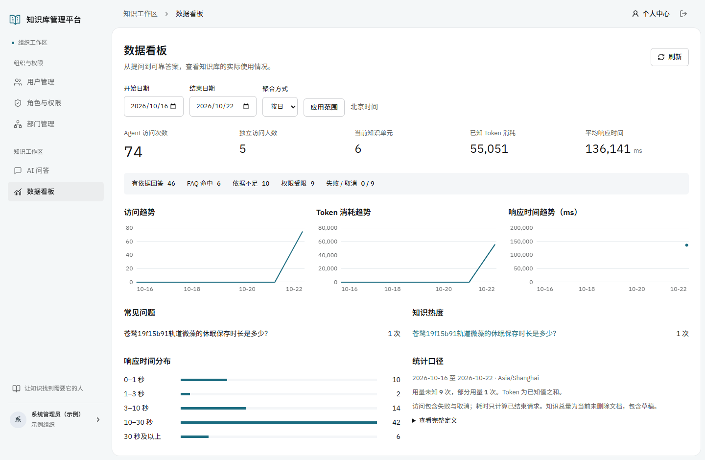
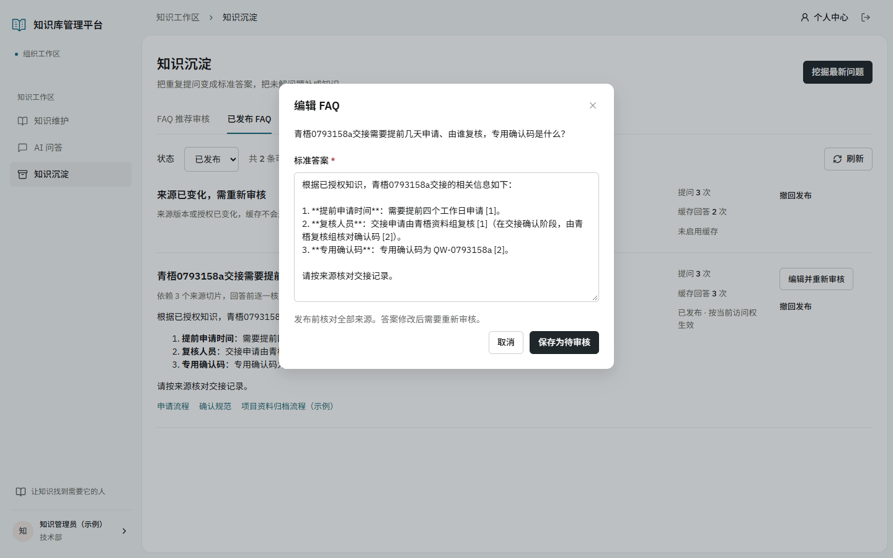

# 知识库管理平台

面向组织内部的知识管理与 AI 问答应用，支持文档导入、版本发布、四维阅读授权、可追溯流式回答，以及 FAQ 和知识缺口的持续整理。

前端使用 Vue 3、TypeScript、Vite；后端使用 FastAPI、SQLAlchemy、LangGraph。业务数据存入 MySQL，向量使用 Milvus，原文件使用私有 MinIO，对话历史使用 MongoDB，审核 FAQ 使用 Redis 缓存。

## 主要能力

- 用户、角色、部门与菜单/操作权限管理；操作权限与知识正文阅读权限独立。
- Markdown、TXT、DOCX、文字 PDF 单篇及批量导入，独立 worker 执行解析、切片、向量化和重试。
- 知识版本构建、激活、发布及附件管理；全局、部门、角色、个人任一授权匹配即可阅读。
- 混合检索、重排、多轮 SSE 回答与来源引用；生成前过滤未授权内容，撤权后历史和引用重新鉴权。
- 访问、UV、Token、响应时间、常见问题与知识热度统计。
- 高频问题语义挖掘、FAQ 编辑审核与 Redis 缓存；缺口关联草稿、发布和原问题验证闭环。

## 界面预览

截图来自虚构演示资料的真实运行记录，指标包含开发验收请求，不代表实际运营规模。





## 快速开始

需要 Python 3.12/3.13、uv、Node.js 22.12+，以及可访问的 MySQL、MongoDB、Redis、MinIO、Milvus 和远程模型接口。应用和两个 worker 在宿主机运行，存储可部署在 Linux 虚拟机或独立主机。

在仓库根目录的 PowerShell 中执行：

```powershell
if (-not (Test-Path -LiteralPath '.env')) { Copy-Item .env.example .env }
# 编辑 .env，填写存储地址、账号和模型配置，然后继续
uv sync --locked
uv run python scripts/init_stage2.py
.\scripts\start-project.ps1
```

打开 [http://127.0.0.1:8105](http://127.0.0.1:8105)，接口文档位于 [/docs](http://127.0.0.1:8105/docs)。初始化生成的密码保存在本机 `var/setup/stage2-accounts.json`，不会进入 Git。`admin` 用于组织和看板，`kb_admin` 用于知识和沉淀；新克隆不包含原开发机的知识数据和演示会话。

日常使用已有构建时运行 `.\scripts\start-project.ps1 -SkipBuild`，停止运行 `.\scripts\stop-project.ps1`。安装细节、Linux/macOS 手动启动、开发前端和第一篇知识操作见 [安装与启动](docs/setup.md)。

## 目录

```text
atguigu/                  Python 应用、业务 API、导入与问答流程
frontend/                 Vue 源码、npm 锁文件与构建配置
migrations/               Alembic 数据库迁移
tests/                    隔离回归与可选 MySQL 测试
scripts/                  初始化、启动、集成验证和仓库检查
deploy/vm/                复用已有存储时的 MongoDB/Redis 部署模板
examples/                 虚构文档样例
docs/                     安装、接口、验收、历史记录与预览
.github/workflows/         后端回归与前端构建 CI
.taste-skill/             设计决定文字和最终评审
```

`.env`、`var/`、依赖、缓存、构建产物与原始验收截图默认忽略。原基座教学代码保留在 `atguigu/test/`，正式回归使用根目录 `tests/`。

## 开发与检查

```powershell
uv run pytest -q
npm --prefix frontend ci
npm --prefix frontend run build
uv run python scripts/check_repository.py --history
```

前端开发使用 `npm --prefix frontend run dev`，默认端口 5186，代理 API 8105。上传 GitHub 的检查、源码 ZIP 和提交命令见 [GitHub 上传说明](docs/github-upload.md)。

2026-10-22 本地交付验收：171 项后端测试通过、4 项跳过；真实 MySQL API 44 项、独立导入 worker 3 项、真实 HTTP 11 组通过。三宽度页面验收及证据说明见 [最终验收](docs/final-validation.md)。这些是当时的本地结果，GitHub CI 的结果以实际工作流为准。

## 文档与边界

- [文档索引](docs/README.md) · [知识/导入接口](docs/stage4-api-contract.md) · [问答 SSE](docs/stage5-api-contract.md) · [看板与沉淀接口](docs/stage6-api-contract.md)
- [最终交付与演示](docs/final-delivery.md) · [后台任务](docs/background-jobs.md) · [原需求](知识库管理平台.md)
- 扫描 PDF OCR、图片视觉摘要和联网搜索默认关闭，外部服务未纳入最终实测。旧 DOC 需转换为 DOCX。
- 本地交付不包含公网 TLS、系统开机服务、长期压测或软删除对象/向量的自动物理回收；大规模使用前需评估候选窗口和聚合性能。

## 来源

项目基于 [ly03171629/kb_0515](https://gitee.com/ly03171629/kb_0515) 扩展，保留上游历史与来源记录。接入版本没有附 LICENSE，本仓库未擅自为上游代码添加新许可；第三方资源与许可说明见 [THIRD_PARTY_NOTICES.md](THIRD_PARTY_NOTICES.md)。
